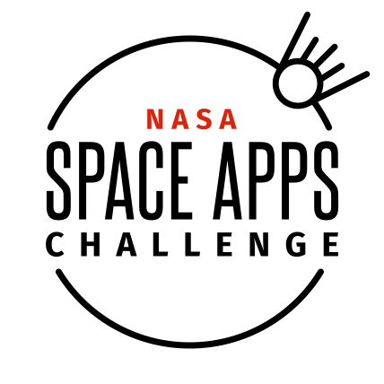

<picture>
  <source media="(prefers-color-scheme: dark)" srcset="public/nanta-logo-white.svg">
  
</picture>

# Nanta

**Choose the path under the Sun and the Earth.**

Live at [nanta.us](https://nanta.us/).

Nanta compares candidate locations and times against the conditions a mission
needs, and shows when each one works, for how long, and what changes if the plan
moves. Conditions are layers over time at a location. The first case is landing
sites at the lunar south pole, where sunlight decides power and Earth's position
decides direct communication. Earth, Mars, and Mercury sites work the same way.

- **Sites and windows.** Pick a site, or add your own coordinates, and a window
  of dates up to 31 days.
- **Sun and Earth against the horizon.** A compass from the site, the elevation
  now, hours above the horizon, and time to the next sunset or Earthset.
- **Compare.** Pin a site and a window as a candidate, then compare any
  candidate against the reading in view, as a diff: a launch slip or a moved
  landing reads as a change.
- **A true model.** Space as it is now, and the sky from the site, matched to
  Horizons within a few tenths of a degree.
- **Imagery.** NASA pictures of the site, ringed at its point.

<a href="https://www.spaceappschallenge.org/">
  <picture>
    <source media="(prefers-color-scheme: dark)" srcset="public/space-apps-white.svg">
    
  </picture>
</a>

Built for the
[NASA Space Apps Challenge 2026](https://www.spaceappschallenge.org/) challenge
[Lunar Landing Site Navigator](https://www.spaceappschallenge.org/2026/challenges/lunar-landing-site-navigator/).
Project page:
[Nanta on Space Apps](https://www.spaceappschallenge.org/2026/find-a-team/will11/?tab=project).

## Preview

## Name

**Semantic.** Nanta comes from the Quechua _ñanta_, "the path", as the one you
take: _ñan_ is the road, and _-ta_ marks it as what you choose. It's the word in
Qhapaq Ñan, the Inca road network across the Andes. It's written without the ñ
so it reads and types easily in English.

**Symbolic.** Nanta represents an explorer's choice: taking the most favorable
path through hard terrain, with clarity in uncertainty and the patience to wait
for the right moment.

## Status

Built in two days during the hackathon, November 14 to 15, 2026, starting from
zero: no prior work, and no prior experience with the APIs or the domain. It was
built the way it was learned, from space down to a site: globes first, then
their shape and spin, then light, then the places on them and their horizons.

- [Code as of challenge submission](https://github.com/willyelm/nanta/tree/challenge-submission):
  the project exactly as submitted, kept for the record.
- `main`: the current state, with the fixes and improvements made after the
  submission. See the [post challenge log](docs/2026-320.md).

**Where it stands.** The ephemeris is real and tested: every body is checked
against recorded Horizons answers, within 1.5°. The navigation, from space to a
single horizon, works for any body and any landing plan, not only the Moon.

**What's next.** Terrain is the gap. The horizon is still a smooth sphere, and
at the lunar south pole a ridge can be the whole answer. Next are a horizon
profile per site from LOLA and MOLA heights, illumination and Earth visibility
maps, and time with the people who would use it.

## Tech stack

- **[React](https://react.dev/) 19**, rendered on the server and resumed in the
  browser.
- **[Three.js](https://threejs.org/)** for the 3D scene: bodies, spin, light,
  and the sky from a site.
- **[Cloudflare Workers](https://workers.cloudflare.com/)** for the server and
  the thin API wrappers over NASA data, cached at the edge.
- **[TypeScript](https://www.typescriptlang.org/)**, run directly by Node, and
  **[esbuild](https://esbuild.github.io/)** for the bundles.
- **[Tailwind CSS](https://tailwindcss.com/) 4** for styles.
- **[Biome](https://biomejs.dev/)** for linting and formatting, and Node's own
  test runner with jsdom for tests.

Three runtime dependencies: `react`, `react-dom`, and `three`. No database.

## Requirements

- [Node.js](https://nodejs.org/) 24 or later, which runs the TypeScript build
  and test scripts directly.
- npm 11 or later.
- A [Cloudflare](https://www.cloudflare.com/) account only to deploy; local
  development runs on Wrangler.

## Run

```sh
npm install
npm run dev
```

Other scripts:

```sh
npm test           # tests
npm run typecheck  # TypeScript
npm run lint       # Biome
npm run build      # production bundles
npm run deploy     # deploy to Cloudflare Workers
```

## Specification

[Specification](docs/README.md)

## Logs

- [Day 318, November 14, 2026](docs/2026-318.md)
- [Day 319, November 15, 2026](docs/2026-319.md)
- [Day 320, November 16, 2026: post challenge](docs/2026-320.md)

## Data

- [JPL Horizons](https://ssd.jpl.nasa.gov/horizons/), for Sun and Earth
  positions from a site on any body, and each body's place in space.
  Ephemerides: NASA/JPL-Caltech Solar System Dynamics.
- [Moon Trek](https://trek.nasa.gov/moon/), NASA, for lunar imagery: the LRO
  wide-angle camera mosaic and LOLA color relief, as map tiles. Imagery:
  NASA/GSFC/Arizona State University (LROC).
- [Mars Trek](https://trek.nasa.gov/mars/) and
  [Mercury Trek](https://trek.nasa.gov/mercury/), NASA, for Viking, MOLA, and
  MESSENGER mosaics. Imagery: NASA/JPL-Caltech, and NASA/JHU-APL/Carnegie
  Institution of Washington (MESSENGER).
- [NASA GIBS](https://www.earthdata.nasa.gov/engage/open-data-services-software/earthdata-developer-portal/gibs-api),
  for Earth: Blue Marble, and the day's VIIRS picture from NOAA-20. We
  acknowledge the use of imagery provided by services from NASA's Global Imagery
  Browse Services (GIBS), part of NASA's Earth Science Data and Information
  System (ESDIS).

This project is not endorsed by NASA. Data and imagery courtesy of NASA.

## Use of AI tools

I wrote the foundation of the code, the principles, and much of the first
implementation, especially the React app's rendering and runtime. From there I
used AI, Claude Code (Anthropic), as a tool in my workflow: I directed it to
extend and refactor code, reviewed what it produced, and edited the code by hand
throughout. I also used it to check the model against Horizons and to help edit
the specification and logs.

## License

[Apache License 2.0](LICENSE).
