# Nanta: Product Design Specification

Nanta shows the Sun and the Earth against the horizon for a place and a date
window. The planner reads the numbers and decides what to keep. The software
does not score the place.

## Goals

A planner, or a member of the public can judge a landing place and a date
without learning Horizons, Moon Trek, or Quickmap.

The final goal is one reading, held on one screen:

- Where the Sun is against the horizon, so power is visible: elevation, how long
  the light lasts, and how long until sunset.
- Where the Earth is against the horizon, so a direct link is visible:
  elevation, how long the link lasts, and how long until Earthset.
- Several places and dates at once, so a slipped launch or a moved site can be
  judged without starting over. The comparison stays on the screen. The person
  does not have to hold it in memory.
- The same view for a specialist and a newcomer. A south-pole place next to a
  familiar Earth day shows why a small move of place or date changes the
  mission.

## Scope

Browsing bodies, sites, and date windows to summarize conditions: the Sun above
the horizon, which is power, and the Earth above the horizon, which is a direct
radio link home.

Candidates, a site and a window pinned together, are compared one against
another, so a slipped launch or a moved landing is read as a change.

The Moon is `301`, Earth is `399`, Mars is `499`, and Mercury is `199` in
Horizons.

It does not score a place or rank places. Imagery shows the ground, but not its
heights: hills, slopes, and dust are a separate study.

## 1. Product foundations

The human interaction and design language follows operational standards based on
WCAG 2.2[^wcag2], the ARIA Authoring Practices Guide[^apg], and NASA-STD-3001
Volume 2[^nasa3001]. These apply as relevant, favoring the spaceflight
guideline. The system is built with modularity and lower abstraction, so the
result stays precise at the runtime.

### 1.1 Identity

Nanta is the Quechua _ñanta_, "the path", the one you take. _Ñan_ is the road.
_-ta_ marks it as the one chosen. It is the word in Qhapaq Ñan, the Inca road
across the Andes. It is written without the ñ so it reads in English.

That is the product. Browsing bodies, sites, and date windows is how a path gets
chosen. The summary, Sun and Earth above or below the horizon, is what makes one
path favorable and another poor.

### 1.2 Colors and schemes

The scheme choice is System, Light, or Dark (`auto`, `light`, `dark`), stored as
`scheme`; `auto` is the default, stored as no value, and follows the system
live. Density is Regular or Compact, stored as `density`; Regular is the default
and Compact tightens the spacing tokens. The resolved `light` or `dark` is set
on `<html data-scheme>`, and the density on `<html data-density>`, both before
the first paint.

| Token                              | Use                                       |
| ---------------------------------- | ----------------------------------------- |
| `--background-color-neutral`       | Page, and buttons and inputs at rest      |
| `--background-color-neutralHover`  | Hover on a neutral item                   |
| `--background-color-neutralActive` | Pressed or current neutral item           |
| `--background-color-accent`        | The accent button: the text color, filled |
| `--text-color-default`             | Text                                      |
| `--text-color-secondary`           | Secondary text                            |
| `--text-color-onAccent`            | Text on the accent: the page color        |
| `--text-color-more`, `-less`       | Compare card: more or less of a condition |
| `--border-color-control`           | Buttons and links that act as controls    |
| `--border-color-input`             | Text inputs                               |
| `--border-color-divider`           | Panels and page dividers                  |
| `--outline-color-focus`            | The focus ring, cochineal, inside         |
| `--chart-color-sun`, `-earth`      | Sun and Earth lines and curves, fixed     |
| `--chart-color-horizon`            | Horizon, orbits, and the ground, fixed    |
| `--chart-color-select`             | Cochineal: selection and focus rings      |
| `--body-color-*`                   | Each body's sphere in the model           |

Cochineal, the Andean dye behind the crimson and magenta of Paracas and Inca
textiles and quipu cords, is the ring color: the selection rings in the model
and the focus ring, drawn inside the edge. It is never a fill, so the focus ring
always shows. The accent button is the text color filled, lettered in the page
color. Blue only means the Earth. Panels, the Compare card, and the Appearance
menu sit over the model as `bg-neutral/80` with a blur, so the scene shows
through.

The chart colors are hex, because WebGL reads hex and rgb only, and are the same
in both schemes: each sits at mid luminance, 3:1 on every neutral step, light
and dark. The body colors are a picture rather than a cue, so they are not held
to 3:1, and the dark scheme lightens them.

Operational text on its background is 6:1, the NASA-STD-3001[^nasa3001] contrast
for text that an operator reads. Control and input borders, the focus outline,
and other non-text cues are 3:1 against the surface they sit on. Dividers are
decorative.

### 1.3 Typography

Nanta Mono is a manual subset of Commit Mono Regular. Weight 400, upright, 16px.
CSS only names the family. The file holds the rest. There is no bold: emphasis is
the default text color against secondary, and case.

`0` uses `cv07`, `l` uses `cv10`, and `1` uses `cv11`, so `0`/`O` and
`1`/`l`/`I` stay distinct. Digits are equal width. Word spacing is a required
feature (`rclt`) in the file. 16px sits above the about-14px body size for a 60
cm console. Confirmation is on the real display.

#### Sizes

Spacing is a 4px grid of tokens, `nano` (2px), `xs`, `sm`, `md`, `lg`; Compact
halves the small steps. The theme replaces Tailwind's scale, so only these names
exist. Controls are `control`, 44px, the touch target: every button, input, and
bar is at least that tall, so a bar of buttons and a bar of text line up. Icon
buttons are `control` wide, not `aspect-square`, which grows in a stretched row.

### 1.4 Model

Three ideas, kept apart so they mix and match:

- A site is a place: a body, a point on it (latitude, longitude), and the
  conditions it is judged on.
- A window is a time: a range of UTC dates with its own code, not tied to a
  site. At most 31 days, Horizons' limit.
- A candidate is a plan: one site and one window, saved by name.

The same site in another window is a launch slip. The same window at another
site is a moved landing. Candidates are what get compared, one against the
reading in view, from the Candidates bar.

## 2. Workspace, layout, and elements

### 2.1 Application shell

The model fills the screen behind everything. Over it, a header and a stable
shape that does not change between pages:

- The header: the name, the Camera readout at the center, the UTC clock, and the
  Appearance menu. The menu holds the scheme (System, Light, Dark) and the
  density (Regular, Compact). Its trigger shows a short code, `S/R` or `D/C`,
  next to a swatch of the accent over the page color.
- A row of side panels: Bodies or Sites on the left, Windows on the right. Each
  panel is as tall as its content, up to the row, then scrolls.
- The Reading across the bottom, with a site: its bar holds the Candidates, the
  Pin button, and Expand. Expanded, it fills the screen and the bar keeps the
  site and window in view. Without a site, the Candidates bar stands alone.

Pages only fill the panels. Empty space passes the pointer to the model, so it
can be turned anywhere it shows. On narrow screens the panels stack below the
model.

The Camera readout's Target is what the camera looks at and turns around: the
site's code with azimuth and elevation in the body's frame, or the body's code,
or Space, with longitude and latitude on the ecliptic, then the distance.

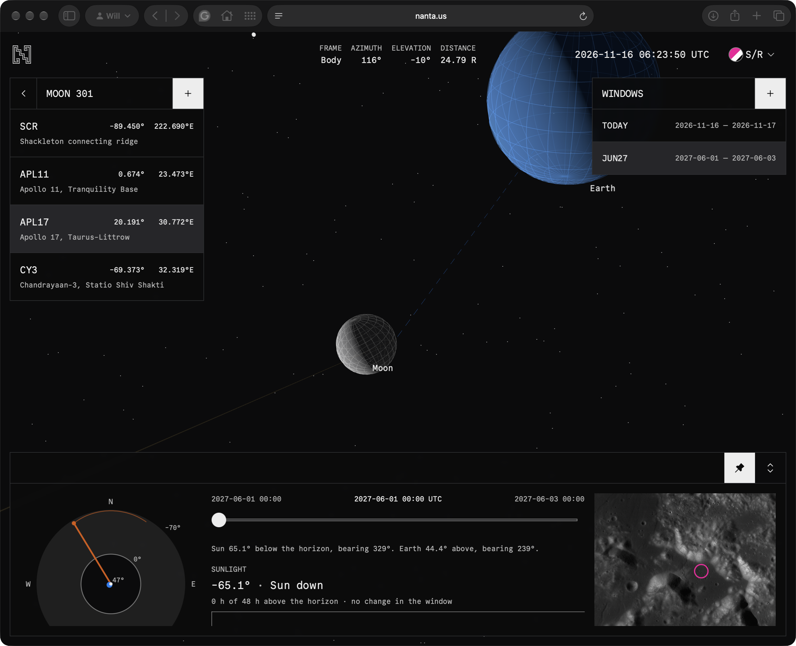

> APL17 in JUN27. The model fills the screen; Sites on the left and Windows on
> the right sit over it, and the Reading runs across the bottom: the Compass,
> the slider and Conditions, and Moon Trek imagery. The Earth hangs in the sky
> with its dashed link to the site.

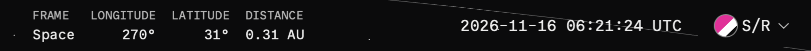

> The header, zoomed. The Camera readout names the target and the camera's angle,
> here Space at longitude 270°, latitude 31°, 0.31 AU. Then the UTC clock, and
> the Appearance menu's trigger, `S/R`, beside its swatch of the accent over the
> page.

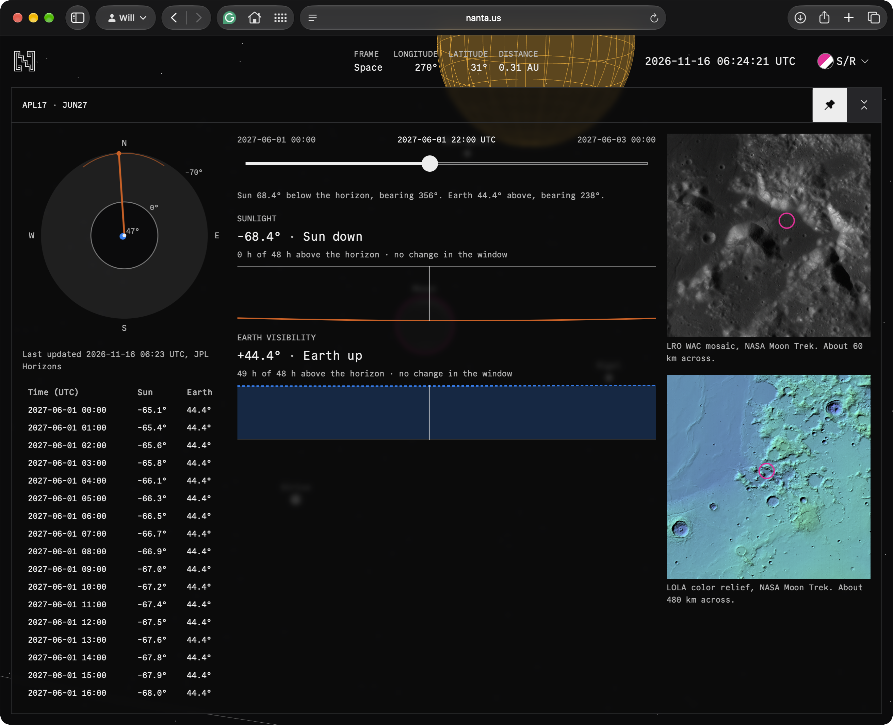

> The Reading expanded at `?reading=full`. The side panels step away and the bar
> keeps `APL17 · JUN27` in view with the Pin and Collapse buttons. The Compass
> and Raw samples, the Conditions with their curves, and two imagery layers fill
> the screen.

### 2.2 Navigation

The URL is the state.

- `/` is the body list.
- `/{code}/sites` is that body's sites.
- `/{code}/sites/{site}?window=` is one place on that body, in one window, and
  `&reading=full` when the Reading fills the screen.

A link moves among these. Back, refresh, and a shared link restore the same
reading. An unknown path is "Page not found." The server answers 404.

## 3. User flows

Each view is one step. The URL changes. The reading updates in place.

The three recordings follow the flow in order, from space down to a decision.

<video src="media/nanta-body-navigator.mp4" controls muted playsinline width="100%"></video>

> [1. Bodies](media/nanta-body-navigator.mp4). Start in space and travel to a
> body.

<video src="media/nanta-site-navigator.mp4" controls muted playsinline width="100%"></video>

> [2. Sites](media/nanta-site-navigator.mp4). Pick a site and land on its
> horizon.

<video src="media/nanta-candidate-compare.mp4" controls muted playsinline width="100%"></video>

> [3. Compare](media/nanta-candidate-compare.mp4). Compare candidates against
> the reading in view.

### 3.1 Body selector

`/` lists the bodies a site can stand on. Pointing at or focusing one moves the
model to it. A body opens `/{code}/sites`.

| Name    | NAIF ID | Air | Horizon   | Solar day      | Radius     |
| ------- | ------- | --- | --------- | -------------- | ---------- |
| Moon    | `301`   | No  | Geometric | `29d 12h 44m`  | 1,737.4 km |
| Earth   | `399`   | Yes | Refracted | `01d 00h 00m`  | 6,371.0 km |
| Mars    | `499`   | Yes | Geometric | `01d 00h 40m`  | 3,389.5 km |
| Mercury | `199`   | No  | Geometric | `175d 22h 30m` | 2,439.7 km |

The whole card is the link. The air line is why elevation `0°` is not the same
fact on every body. The Sun and the reference stars are in the model, never in
the list: they are references, not places.

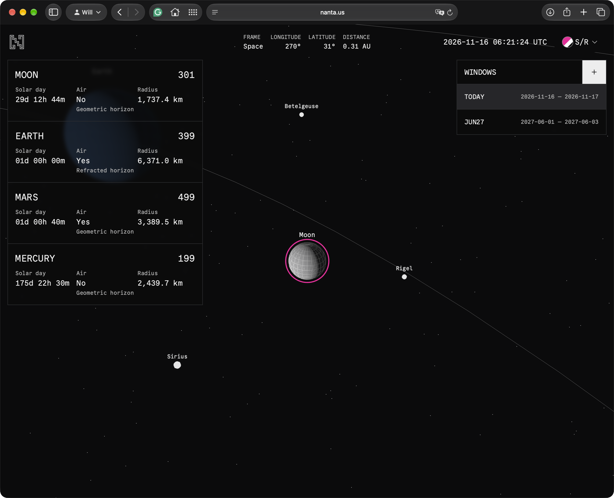

> The first page, `/`. Space as it is now, from Horizons: the Moon ringed in
> cochineal, the ecliptic as a faint line, and the brightest stars named. Bodies
> on the left, Windows on the right.

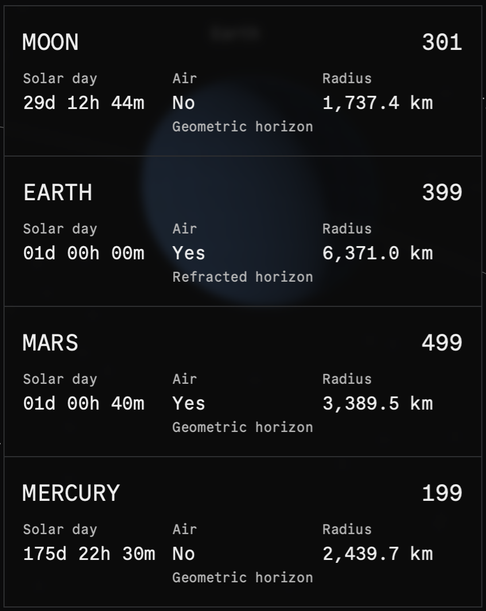

> Bodies, zoomed. Each card is the link: name and NAIF ID, solar day, air,
> radius, and the horizon Horizons uses for it, geometric or refracted.

### 3.2 Sites and windows

Each body has its own sites, predefined and your own. A site has a short code
name (`APL11`, `CY3`, `SCR`), a description, its coordinates, and two flags:

- `sunlight`: the Sun above the horizon, which is power.
- `earth_visibility`: the Earth above the horizon, a direct link home.

Moon sites have both; Earth (`KSC`, `INTI`), Mars, and Mercury sites have
sunlight only. The flags decide which bodies Horizons is asked about and what is
drawn. A site is a point: the outline in the model is a fixed marker, since
Horizons answers for a point.

Windows are their own list, predefined (`MAR27`, `JUN27`) and your own, picked
by code. With no site open, picking a window moves the bodies in the model to
its start, so space can be explored by date. Changing the site keeps the window,
and changing the window keeps the site. Your sites and windows are kept in this
browser; the server holds only the predefined ones.

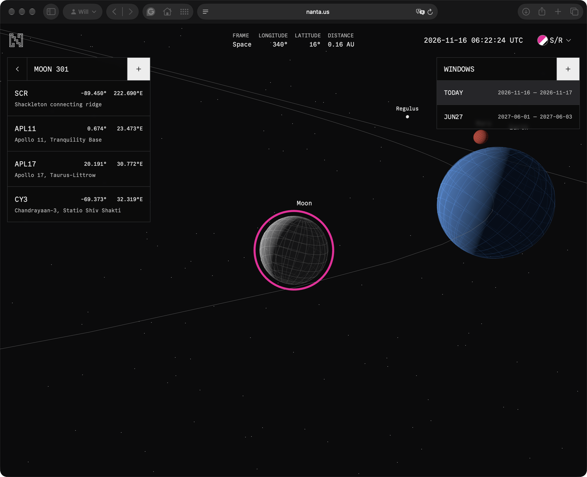

> The Moon at `/301/sites`. The camera has flown to it, ringed, with the Earth
> and Mars where they are. The Sites panel lists its sites, and Windows stays on
> the right.

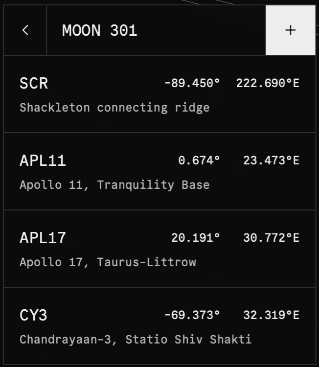

> Sites, zoomed. Code name, latitude and east longitude, and what each place is:
> SCR on the Shackleton connecting ridge, the Apollo 11 and 17 sites, and
> Chandrayaan-3's Statio Shiv Shakti. The back arrow goes up one level, and +
> adds a site.

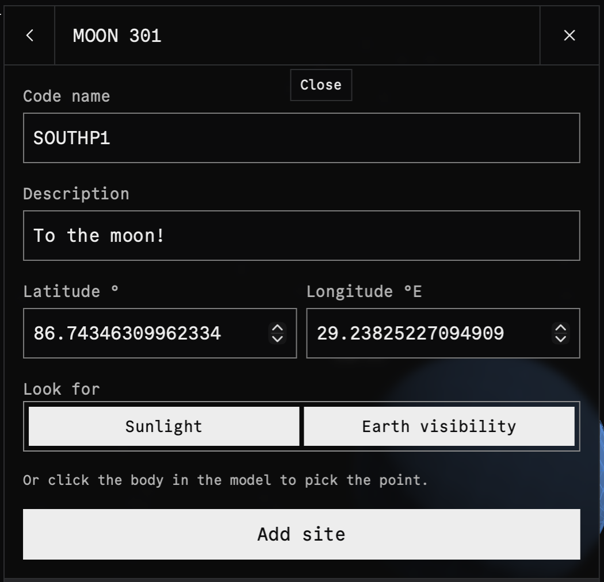

> Adding a site inline: a code name, a description under it, latitude and
> longitude, and Look for (conditions): Sunlight or Earthview. Latitude and
> longitude are spin buttons like the dates: degrees, thousandths, and N or S;
> longitude runs 0 to 360°E. Arrow keys and the wheel step the segment under
> them, Shift by ten, and digits type into it. The ? on Longitude says "You can
> click in the 3D model": a click on the body picks the point, and the model
> follows as you type. A taken code name is the only line under the fields.

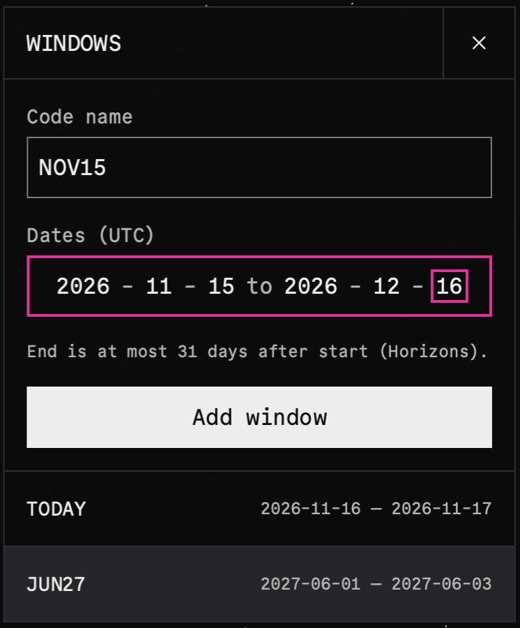

> Adding a window inline: a code name and two UTC dates, typed as spin buttons.
> The ? on Dates says the end is at most 31 days after the start, the Horizons
> limit. Both forms share the same fields, labels, and spacing. The focus ring
> is cochineal, drawn inside the edge.

A site and a window are pinned as a candidate with the Pin button in the
Reading's bar. Candidates sit as boxes in the Candidates bar, body and site over
window (`301/SCR` over `JUN27`), on every page, even before a site is open. A
box opens its pair and keeps the camera; the × on hover unpins it. Candidates
are kept in this browser.

Each box has a chevron on its left that opens the Compare card. Hovering the box
previews it; the chevron keeps it open, so its text can be selected and copied.
It opens below, left-aligned, or above when there is no room, and the chevron
points to it. It reads both at the same hour into each window, and says when:
the first row is each side's date and hour in UTC, so the card stands on its
own. Then, per condition, three facts in columns, the reading in view, then the
hovered candidate: elevation, hours above the horizon, and the next change.
Elevation carries an arrow, up or down from the horizon, named by its tooltip
("Sun up", "Earth down"). The candidate shows its change from the reading in
parentheses, green for more of the condition and red for less; the sign carries
it without color. A fact equal on both reads "same", and a change that can't be
taken (one side has no next change) is left out. It says more or less, never
better or worse.

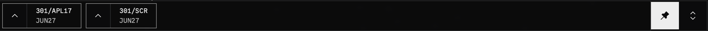

> The Candidates bar, zoomed: `301/APL17` and `301/SCR`, each in `JUN27`, body
> and site over window. The chevron on the left of each box opens the Compare
> card.

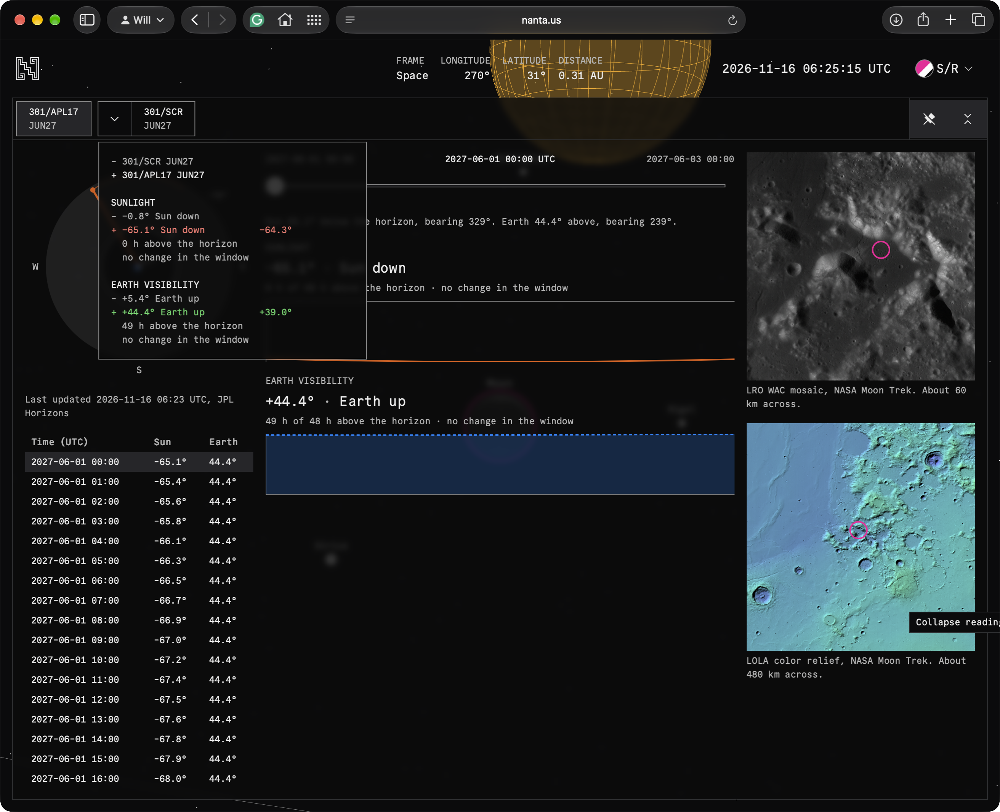

> The Compare card open over the Reading, frosted like the panels, with SCR as
> the candidate and APL17 as the reading in view.

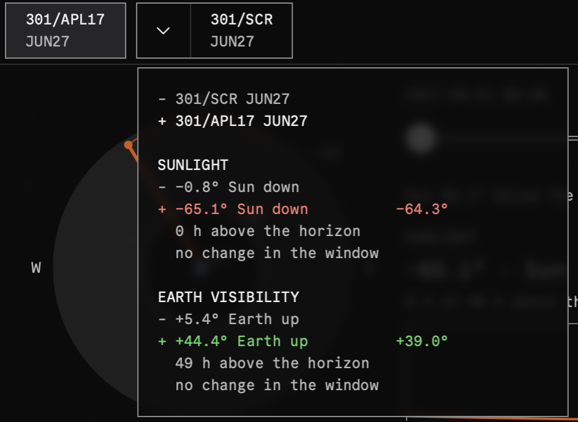

> The comparison, zoomed (this capture predates the columns). Today the first
> column is the reading in view and the second the hovered candidate, its change
> in parentheses: red for less of the condition, green for more, and "same" in
> gray.

### 3.3 The model

One scene, built once, never swapped. A selection moves only the camera.

- Space, before a site: the Sun at the center, and the bodies where they are
  now, from one Horizons state each, advanced by the clock. Directions and
  distances from the Sun are true; sizes are enlarged so each body can be seen,
  with Earth, Moon, Mars, and Mercury in their true ratio.
- A site: the body at the center and the site on it, with its horizon and an
  outline. A cursor-like triangle points at the site, its code above it. The
  camera stands on the skyline with the site's zenith as up, looking toward the
  Earth's bearing, or the Sun's. The other bodies sit along their true
  directions from the site. Distance is the cube root of the real range, so
  order and gaps read, and bodies are true size against the site's body. The Sun
  is fixed, since its true size can't fit.
- The Sun lights every body from where it is, so day, night, and the line
  between them show.
- Each body turns as the IAU model says, its poles and grid true for the time.
  At a site the Sun and the Earth are Horizons' own azimuth and elevation; the
  stars and the other bodies come from the same turn, within about 0.3° of
  Horizons, the Moon's wobble included. Sight lines run from the site to the Sun
  and the Earth.
- The brightest stars, and the four on the ecliptic, are placed in their true
  directions, over a faint filler.

The chart and the model are pictures of the numbers. The panels hold the
reading.

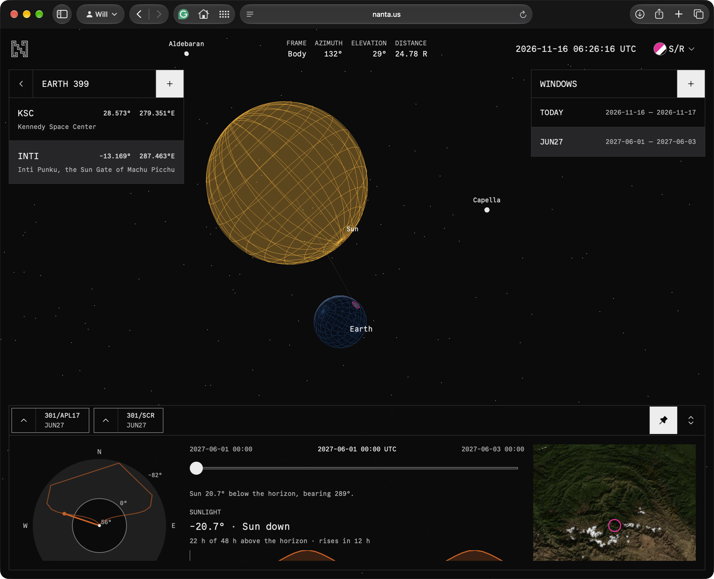

> Earth at INTI, Inti Punku. The Sun sits along its true direction from the
> site, with the sight line to it, and Aldebaran and Capella in their true
> places. The site is ringed on Earth. Below, the Compass traces the Sun's daily
> loop at 13°S and the image is Blue Marble.

### 3.4 Detail

The Reading has three parts, left to right:

- The Compass, and under it the Raw samples table: time in UTC and each
  condition's elevation. Above the table, when Horizons was asked: "Last updated
  2026-11-15 21:40 UTC, JPL Horizons". Units sit on the number. A missing sample
  is a dash. This is the text a planner can quote.
- The time slider and the Conditions, each at the chosen time: hours above the
  horizon in the window, the next rise or set, and one curve, like a forecast.
- Imagery of the site, ringed at its point: Moon Trek for the Moon, Mars Trek
  for Mars, Mercury Trek for Mercury, and for Earth Blue Marble and the day's
  picture from GIBS. A day with no picture yet shows the latest, captioned so.
  Past 80° the Trek grid stretches pictures into streaks, so polar sites say so
  instead, until the polar layers are in.

The slider moves the model, the table row, and the curves together. Its time
sits above the middle of the slider, the date at caption size over the hour at
heading size, between the window's first and last hour.

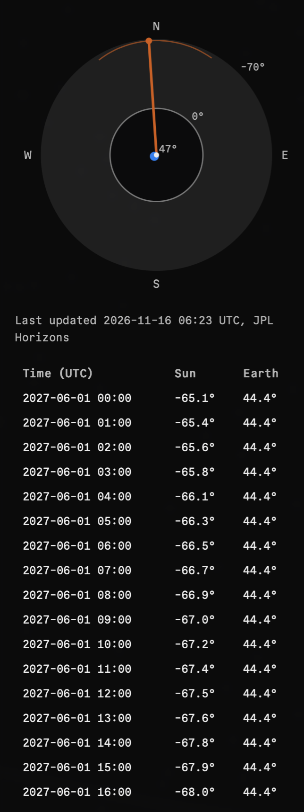

> The Compass and the Raw samples, zoomed. Bearing around, elevation from the
> center out, the ring is the horizon: the Sun's path in orange well outside it,
> the Earth's blue dot inside. Under it, when Horizons was asked, and the table
> a planner can quote.

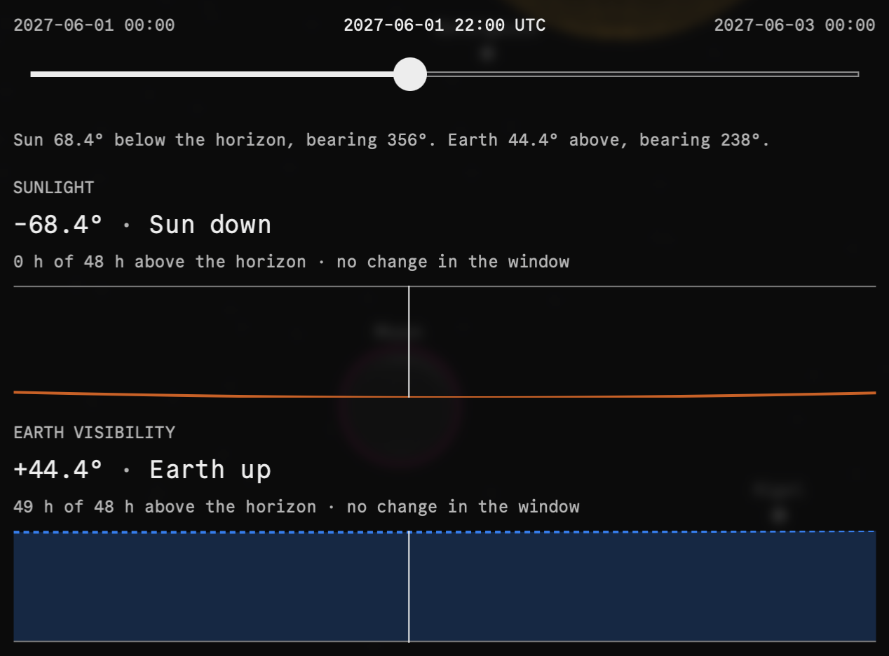

> The slider and Conditions, zoomed. The time in UTC, a one-line summary, then
> each condition: the elevation now, hours above the horizon in the window, the
> next change, and its curve like a forecast.

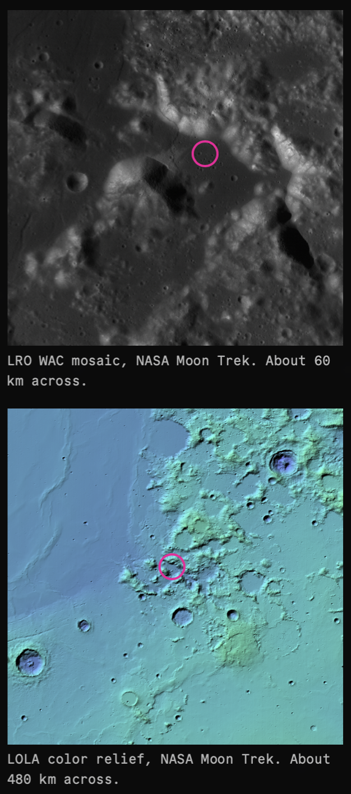

> Imagery, zoomed: the LRO WAC mosaic and LOLA color relief from Moon Trek, each
> with the site ringed at its point and how wide it is on the ground.

## 4. System

### 4.1 Loading and rendering

The server renders the shell and the panels. The model is drawn in the browser
with Three.js, on demand, only while something moves. It loads one body at a
time and says so in a status line.

| State        | What triggers it            | What the user sees                                           |
| ------------ | --------------------------- | ------------------------------------------------------------ |
| Space        | `/` loads                   | The bodies where they are now, and the body list.            |
| No site      | `/{code}/sites` loads       | The body in space, its sites, and "Choose a site."           |
| No window    | A site is chosen            | The site's skyline, the other bodies, and "Choose a window." |
| Loading      | Horizons requests in flight | A skeleton of the same shape, and what is loading.           |
| Ready        | Samples arrive              | Conditions, the table, the curves, and exact directions.     |
| Error        | A request fails             | A panel says what failed. The other panels stay.             |
| Unknown path | No route matches            | "Page not found." The server answers 404.                    |

### 4.2 URL

- `/{body}/sites`: the body's sites.
- `/{body}/sites/{site}?window={window}`: a site, read in a window.
  `&reading=full` keeps the Reading expanded.

Sites and windows you add are edited inline in their panels, so the other panels
stay up; only the place or the window in the URL changes.

Back, refresh, and a shared link restore the reading, the camera angle included.
The window defaults to `TODAY`. The tab title is `Nanta - ` and the place: the
body (`Moon 301`), the site (`SCR`), or the site and window (`SCR/JUN27`). A
site or window added in another browser is not there yet.

### 4.3 Data and limits

A window is one request per condition's body, step `1h`, at most 31 days, made
one at a time: Horizons refuses parallel requests from one client. Space is one
state per body for the current hour. Repeat requests are cached; dev starts with
an empty cache.

Horizons refracts only for sites on Earth, so Earth is requested refracted, and
the Moon, Mars, and Mercury airless: their horizons are geometric. Mars and
Mercury longitudes run west in the IAU frame, so they go to Horizons as negative
east longitudes. No request includes terrain, so the horizon is the smooth
sphere. Trek images are shown, but no heights. The camera angle is kept in the
URL.

`/api/imagery/{body}?lat=&lon=&date=` picks the source for the body and returns
the pictures around the site: three by three Trek tiles, or for Earth two GIBS
pictures 2° across: Blue Marble without clouds, and VIIRS on NOAA-20 for a past
day. It builds the URLs only; the browser loads the images from NASA.

From a site, every body is placed from the site's point, not the body's center:
distances are squashed by a cube root, so only that keeps the direction seen
from the site true. A test holds the model to Horizons: answers recorded for
every catalog site (`scripts/record-horizons.ts`) are replayed offline, and each
body, placed as the scene places it, must sit within 1.5° of where Horizons
says. The worst today is under 0.8°, the Moon from Earth, seen from Earth's
center rather than its surface.

There is no success percentage, no dust, no slope limit, and no hidden rank.

[^wcag2]: [Web Content Accessibility Guidelines (WCAG) 2.2](https://www.w3.org/TR/WCAG22/).

[^apg]: [ARIA Authoring Practices Guide](https://www.w3.org/WAI/ARIA/apg/).

[^nasa3001]: [NASA-STD-3001 Volume 2, Human Factors, Habitability, and Environmental Health](https://standards.nasa.gov/standard/NASA/NASA-STD-3001_VOL_2).
